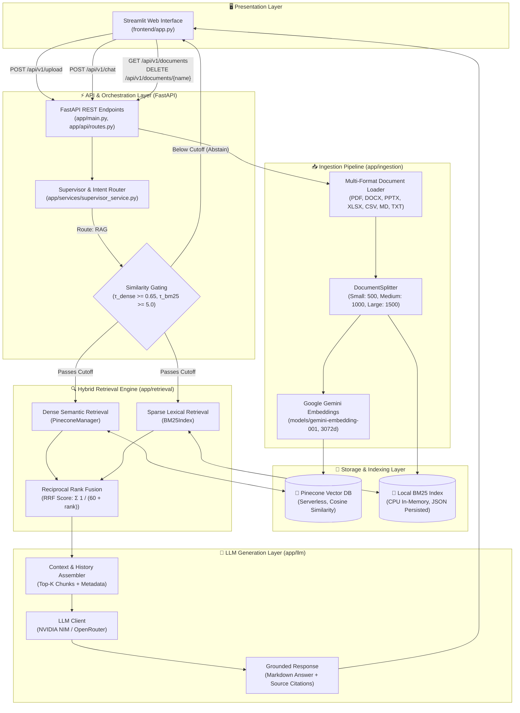

# 🏭 TYRION-2.0 — Industrial Knowledge Intelligence & Decision Support System

> **A Practical Retrieval-Augmented Generation (RAG) System Engineered for Technical & Engineering Documentation**  
> **Author:** Tarun Singh — B.Tech Computer Science (Data Science & AI)  
> **Development Setup:** Windows 10, 8 GB RAM, Integrated Graphics (CPU-first development, Cloud LLM & Embedding inference)

[](https://www.python.org/)
[](https://fastapi.tiangolo.com/)
[](https://streamlit.io/)
[](https://www.pinecone.io/)
[-brightgreen.svg)]()
[](LICENSE)

---

## 1. Project Introduction

**TYRION-2.0** is an academic capstone and portfolio project designed to demonstrate a complete, modular, and defensible Retrieval-Augmented Generation (RAG) architecture.

### The Problem Being Solved
Standard LLM question-answering systems struggle with specialized technical, industrial, and compliance documents (such as ASME boiler codes, API standards, machinery operation manuals, and sensor troubleshooting guides). These documents feature:
- Dense technical jargon, acronyms, and alphanumeric part numbers.
- Structured tabular data and operational thresholds across sheets.
- Critical safety and precision requirements where hallucination cannot be tolerated.

### Intended Use Case & Capabilities
TYRION-2.0 serves as a local decision-support and knowledge-retrieval assistant for engineers and technical reviewers:
1. **Multi-format document ingestion:** Extracts structured text, sections, and tables from PDFs, Office documents (DOCX, PPTX), spreadsheets (Excel, CSV), and Markdown/text notes.
2. **Hybrid semantic and keyword retrieval:** Combines high-dimensional dense vector embeddings with local Okapi BM25 sparse keyword matching via Reciprocal Rank Fusion (RRF).
3. **Similarity threshold gating & abstention:** Filters out low-confidence matches before calling the LLM, safely refusing to answer out-of-corpus queries with 0 citations.
4. **Evidence-grounded responses:** Synthesizes answers citing verified source files, page numbers, and section headings.
5. **Empirical evaluation framework:** Ground-truth benchmarking across a 50-question industrial evaluation dataset with separated Development and Held-Out Test splits.

---

## 2. Key Features

- **Multi-Format Ingestion:** Extracts text from `.pdf`, `.docx`, `.pptx`, `.xlsx`, `.csv`, `.md`, and `.txt` files with clean structure preservation (e.g., Excel sheets converted to Markdown tables with retained column headers).
- **Multi-Granularity Text Chunking:** Configurable character-bounded splitting (`small` = 500 chars, `medium` = 1000 chars, `large` = 1500 chars) assigning canonical, deterministic IDs (`{file_name}_{strategy}_{index}`).
- **Google Gemini Embeddings:** Uses `models/gemini-embedding-001` (3072 dimensions) with verified local dimension caching, eliminating redundant network probe requests during server initialization.
- **Pinecone Dense Retrieval:** Cloud-managed serverless vector indexing with metadata filtering (`file_name`, `document_id`) and cosine distance metrics.
- **Local Okapi BM25 Sparse Search:** Pure Python lexical keyword retrieval running entirely in-memory on CPU in < 0.1 ms with JSON disk persistence.
- **Reciprocal Rank Fusion (RRF):** Merges dense semantic candidates and BM25 lexical candidates using rank-reciprocal scoring ($k=60$) to balance concept understanding with exact keyword matches.
- **Similarity-Gated Abstention:** Evaluates candidate similarity against calibrated thresholds ($\tau_{\text{dense}} = 0.65$, $\tau_{\text{bm25}} = 5.0$). Out-of-scope or irrelevant queries are rejected immediately with zero sources.
- **Grounded LLM Generation:** Connects to cloud LLMs (NVIDIA NIM / OpenRouter) with strict system prompting enforcing evidence-grounded answers and explicit source citations.
- **Document Management:** Full lifecycle API supporting multi-file upload, document listing, individual document deletion (synchronously clearing disk, Pinecone vectors, and BM25 index), and complete index wipe.
- **Live Evaluation Dashboard:** Interactive Streamlit dashboard visualizing empirical benchmark metrics, threshold calibration curves, chunk size sensitivity, latency breakdowns, and qualitative answer reviews.

---

## 3. System Architecture & Communication Flow

The system separates concerns across three primary layers: presentation (Streamlit), API/orchestration (FastAPI), and storage/retrieval (Pinecone + local BM25).



---

## 4. Technology Stack

| Layer / Role | Technology | Implementation Detail & Rationale |
|:---|:---|:---|
| **API Framework** | **FastAPI** + **Uvicorn** | Asynchronous HTTP REST endpoints with automatic OpenAPI documentation and Pydantic schema validation. |
| **Web Frontend** | **Streamlit** | Interactive user interface providing dual-tab layout (Interactive Chat vs. Benchmark Dashboard). |
| **Vector Database** | **Pinecone Serverless** | Cloud-managed vector database operating on AWS (`us-east-1`) with cosine similarity; removes local RAM load. |
| **Sparse Retrieval** | **Okapi BM25** | Custom Python BM25 implementation running on CPU with sub-millisecond retrieval (0.08 ms) and JSON persistence. |
| **Embedding Model** | **Google Gemini** | `models/gemini-embedding-001` (3072 dimensions) accessed via Google AI Studio API. |
| **LLM Inference** | **NVIDIA NIM** / **OpenRouter** | Cloud inference using Nemotron / Llama-3.3 models via OpenAI-compatible endpoints; avoids requiring local GPU hardware. |
| **Document Parsers** | `pypdf`, `python-docx`, `python-pptx`, `pandas`, `openpyxl`, `tabulate` | Format-specific local extraction without cloud document dependencies; optional Mistral OCR for scanned files. |
| **Test Suite** | Python **`unittest`** | 60 unit, integration, and functional validation tests achieving 100% pass rate in ~3.3 seconds. |

---

## 5. End-to-End RAG Pipeline Workflow

```
[1. Document Upload]  ──► User uploads files via Streamlit or POST /api/v1/upload
         │
[2. Text Extraction]  ──► Format-specific parser extracts text, tables, and page metadata
         │
[3. Text Chunking]    ──► DocumentSplitter creates character chunks with canonical IDs
         │
[4. Dual Indexing]    ──► Dense: Chunks embedded via Gemini (3072d) and upserted to Pinecone
                      ──► Sparse: Tokenized terms indexed into local BM25 index
         │
[5. Query Processing] ──► User submits question; Supervisor classifies route (Greeting vs. RAG)
         │
[6. Relevance Gating] ──► Checks whether top scores satisfy similarity thresholds (τ_dense, τ_bm25)
         │
[7. Hybrid Retrieval] ──► Queries both Pinecone and BM25; merges ranks via Reciprocal Rank Fusion
         │
[8. Context Assembly] ──► Formats top-k chunks into structured context with conversation history
         │
[9. LLM Generation]   ──► RAGChain calls cloud LLM with grounded system instructions
         │
[10. Cited Response]  ──► Returns Markdown response accompanied by structured source citations
```

---

## 6. Retrieval Strategy: Dense, Sparse & Hybrid Fusion

### Why Hybrid Retrieval?
Dense vector embeddings capture deep semantic meaning and conceptual synonyms (e.g., understanding that *"elevated temperature"* relates to *"thermal overheating"*). However, dense retrieval can struggle with exact technical alphanumeric codes, standard designations (e.g., *"ASME Section VIII Div 1"*), and specific tag identifiers (e.g., *"API 610"*).

Conversely, BM25 excels at exact keyword matching but cannot capture paraphrased concepts. Combining both through **Reciprocal Rank Fusion (RRF)** provides balanced retrieval:

1. **Dense Retrieval:** Retrieves candidates from Pinecone based on cosine similarity ($\ge 0.65$).
2. **Sparse Retrieval:** Retrieves candidates from the local BM25 index based on Okapi term weighting ($\ge 5.0$).
3. **Reciprocal Rank Fusion:** Evaluates the relative ranks of candidates across both candidate pools using:
   $$\text{RRF Score}(d) = \sum_{m \in \{\text{dense}, \text{bm25}\}} \frac{1}{60 + r_m(d)}$$
   where $r_m(d)$ is the 1-based rank of document $d$ in retrieval method $m$.
4. **Similarity Filtering:** If candidates fail both dense and sparse score thresholds, the system immediately abstains from answering, avoiding hallucinations and saving LLM inference tokens.

---

## 7. Experimental Evaluation & Benchmark Results

The retrieval and generation quality of TYRION-2.0 was experimentally evaluated against a dedicated benchmark dataset:
- **Corpus:** 10 authentic industrial specifications (centrifugal pumps, marine turbochargers, steam boilers, gas turbines, transformers, chillers, pressure vessels).
- **Benchmark Questions:** 50 curated technical questions annotated with ground-truth chunk provenance and answerability labels.
- **Split Isolation:** 35 Development queries (used for threshold calibration and parameter selection) and 15 Held-Out Test queries (unseen validation).

### Benchmark Results (Held-Out Test Split, $N=15$)

*Evaluated with frozen calibrated thresholds: $\tau_{\text{dense}} = 0.65$, $\tau_{\text{bm25}} = 5.0$, $K=5$, $RRF\ k=60$.*

| Retrieval Pipeline | Hit Rate@5 [95% CI] | Recall@5 [95% CI] | Precision@5 [95% CI] | MRR [95% CI] | Correct Abstention Rate (CAR) | Mean Latency |
|:---|:---:|:---:|:---:|:---:|:---:|:---:|
| **Dense Semantic (Pinecone)** | **0.9091** [0.73, 1.0] | **0.9091** [0.73, 1.0] | 0.1818 [0.15, 0.20] | **0.9091** [0.73, 1.0] | **100.0% (4/4)** | 861.98 ms |
| **Sparse Lexical (Okapi BM25)** | 0.8182 [0.55, 1.0] | 0.8182 [0.55, 1.0] | 0.1636 [0.11, 0.20] | 0.8182 [0.55, 1.0] | **100.0% (4/4)** | **0.08 ms** |
| **Hybrid RRF (Dense + BM25)** | **0.9091** [0.73, 1.0] | **0.9091** [0.73, 1.0] | 0.1818 [0.15, 0.20] | **0.9091** [0.73, 1.0] | **100.0% (4/4)** | 862.31 ms |

> *Precision@5 Clarification:* In this evaluation benchmark, each answerable query is mapped to exactly 1 primary ground-truth target chunk. Retrieving $K=5$ chunks yields a mathematical maximum precision of $1/5 = 0.2000$.

### Latency Decomposition Profile
- **Local BM25 Lookup:** **0.08 ms** (pure CPU memory lookup).
- **Cloud Embedding Generation:** **689.58 ms** (Google Gemini API network round-trip).
- **Pinecone Vector Search:** **172.40 ms** (Serverless vector search round-trip).
- **RRF Rank Fusion:** **0.30 ms** (in-memory candidate scoring).
- **Total Hybrid Retrieval:** **862.36 ms** (dominated by cloud network latency).

### Qualitative Answer Generation Assessment (Pilot Sample)
A human-reviewed pilot audit was conducted across 6 representative industrial questions (factual lookup, calculation, troubleshooting, comparison, and out-of-domain abstention):
- **Faithfulness:** 1.0 (verified verbatim against technical parameters in the source text).
- **Answer Relevance:** 1.0 (directly addressed the query requirements).
- **Citation Validity:** 100% (every citation mapped directly to a verified retrieved document and section).
- **Abstention Safety:** Out-of-corpus queries (e.g., quantum computing questions) triggered correct rejection with zero source citations.
- *Disclosure:* Generation quality was assessed via this 6-question qualitative diagnostic sample; it does not claim to be a large-scale statistical benchmark.

---

## 8. Installation & Setup Guide

### System Requirements
- Windows 10/11, macOS, or Linux.
- Python 3.11 or higher.
- 8 GB RAM (runs comfortably on CPU).
- Internet connection (for cloud embedding and LLM APIs).

### Step 1: Clone the Repository
```powershell
git clone https://github.com/Tarunsingh465/TYRION-2.0.git
cd TYRION-2.0
```

### Step 2: Create and Activate Virtual Environment
```powershell
python -m venv .venv
.\.venv\Scripts\activate          # On Windows
# source .venv/bin/activate       # On Linux/macOS
```

### Step 3: Install Dependencies
```powershell
pip install -r requirements.txt
```

### Step 4: Configure Environment Variables
Copy the template to create your `.env` file:
```powershell
copy .env.example .env            # On Windows
# cp .env.example .env            # On Linux/macOS
```

Edit `.env` with your API credentials:
```ini
# Primary LLM Provider: NVIDIA NIM (Free tier at https://build.nvidia.com)
NVIDIA_API_KEY=nvapi-your-nvidia-api-key

# Vector DB & Embeddings:
GOOGLE_API_KEY=your-google-api-key       # Free from Google AI Studio
PINECONE_API_KEY=your-pinecone-api-key   # Free Serverless tier from Pinecone

# Pinecone Index Settings:
PINECONE_INDEX_NAME=tyrion-2-0
PINECONE_NAMESPACE=default

# Model Settings:
LLM_MODEL=meta/llama-3.3-70b-instruct
EMBEDDING_MODEL=models/gemini-embedding-001
EMBEDDING_DIMENSION=3072

# Retrieval & Chunking:
TOP_K=5
RAG_SIMILARITY_THRESHOLD=0.55
CHUNK_SIZE=1000
CHUNK_OVERLAP=200
```

### Step 5: Start the FastAPI Backend
```powershell
python run.py
```
- API will start at: `http://127.0.0.1:8000`
- Interactive Swagger UI: `http://127.0.0.1:8000/docs`
- Health check: `http://127.0.0.1:8000/health`

### Step 6: Start the Streamlit Frontend
In a separate terminal window:
```powershell
.\.venv\Scripts\python.exe -m streamlit run frontend/app.py
```
- Web UI will launch at: `http://localhost:8501`

### Step 7: Run the Automated Test Suite
Execute all 60 tests to verify full pipeline integrity:
```powershell
python -m unittest discover tests
```

---

## 9. Usage Guide & Demonstration Scenarios

### Workflow 1: Document Upload & Indexing
1. Open the web interface at `http://localhost:8501`.
2. In the left sidebar under **Upload & Ingest**, click **Browse files** and select one or more technical documents (`.pdf`, `.docx`, `.xlsx`, `.md`, etc.).
3. Click **Upload & Index**. The backend extracts text, generates chunks, computes Gemini embeddings, and indexes them into Pinecone and BM25.
4. The uploaded files appear under **Knowledge Base Documents** with individual delete buttons.

### Workflow 2: Asking Questions with Grounded Citations
1. In the chat input, ask a specific technical question (e.g., *"What is the minimum shell thickness formula under ASME Section VIII?"*).
2. The system executes hybrid retrieval, presents the answer in structured Markdown, and attaches source cards showing:
   - File name (e.g., `pressure_vessel_asme_sec_viii.md`)
   - Page number (e.g., `Page 1`)
   - Section heading (e.g., `Maximum Allowable Working Pressure`)

### Workflow 3: Out-of-Domain Abstention
1. Ask a question unrelated to the uploaded documentation (e.g., *"Who was Napoleon Bonaparte?"*).
2. The relevance gating check detects that cosine similarity is below the threshold ($\tau = 0.65$) and BM25 score is below $5.0$.
3. The system returns an **Out-of-Domain Request** notice without calling the LLM and without displaying citations.

### Workflow 4: Document Deletion
1. In the sidebar under **Knowledge Base Documents**, click the 🗑 button next to any document.
2. The backend deletes the file from local storage, purges its vectors from Pinecone, and removes its entries from the BM25 index.

### Workflow 5: Benchmark Dashboard
1. Switch to the **Evaluation & Benchmark Dashboard** tab in the web interface.
2. View live metrics for Development and Held-Out Test splits, threshold calibration curves, chunk size sensitivity, latency decompositions, and qualitative answer audits.

---

## 10. Demonstration Checklist

To demonstrate the application during an evaluation or interview, follow this checklist:

| Step | Action | Expected Demonstration Behavior |
|:---:|:---|:---|
| **1** | **Application Launch** | Backend starts on port 8000; frontend opens on port 8501 with status indicator showing `ONLINE` (green). |
| **2** | **Document Upload** | Upload an industrial specification (e.g., `marine_diesel_turbocharger_manual.md`). Ingestion completes and file appears in sidebar list. |
| **3** | **Technical Retrieval Query** | Ask: *"What is the nominal compressor pressure ratio of the turbocharger?"* → System retrieves manual and answers *"3.8:1 with max rotor speed 18,500 RPM"* with source citation. |
| **4** | **Engineering Problem-Solving** | Ask: *"Why is my 4-20mA loop saturating above 20.8 mA?"* → System identifies ground loop interference and cites troubleshooting guide. |
| **5** | **Abstention Verification** | Ask: *"What is the quantum superposition decoherence time?"* → System safely abstains stating documentation does not cover quantum physics (0 citations). |
| **6** | **Document Deletion** | Click 🗑 next to the uploaded document → Document is removed from sidebar and vector database; subsequent queries abstain. |
| **7** | **Evaluation Review** | Switch to the Evaluation tab → Walk through the 50-question benchmark, split design, and latency comparison (BM25 0.08 ms vs. Dense 861.9 ms). |

---

## 11. Known Limitations

1. **Cloud Embedding Latency:** Dense vector retrieval requires an external API call to Google Generative AI (~689 ms network latency), which dominates overall retrieval time compared to local BM25 (0.08 ms).
2. **In-Memory BM25 Scale:** The BM25 index is maintained in-memory with JSON disk persistence. This is efficient for small-to-medium collections (< 10,000 chunks) but would require a disk-backed inverted index engine (such as Tantivy or Lucene) for enterprise-scale corpora.
3. **Session-Based Chat History:** Chat history is stored in Streamlit session state and is cleared when the browser tab is refreshed, rather than persisting in an external database.
4. **Evaluation Dataset Size:** The quantitative benchmark is based on 50 curated technical questions across 10 documents; while sufficient for capstone validation and threshold calibration, it is not an exhaustive multi-thousand query enterprise benchmark.
5. **External API Dependency:** Cloud inference (NVIDIA NIM / OpenRouter) and embeddings (Google Gemini) require an active internet connection and valid API credentials.

---

## 12. Realistic Future Improvements

- **Cross-Encoder Re-Ranking:** Implement a secondary re-ranking stage using a lightweight cross-encoder (e.g., `BAAI/bge-reranker-base`) to score top RRF candidates before LLM synthesis.
- **Persistent Chat History:** Persist conversation threads and feedback in an SQLite or PostgreSQL database with session tokens.
- **Quantized Local Embeddings:** Add an optional local embedding fallback (e.g., ONNX-quantized `all-MiniLM-L6-v2`) for completely offline execution.
- **OCR Table Boundary Detection:** Enhance scanned document parsing with specialized table-structure recognition models.

---

## 📄 License & Attribution

- **Project:** TYRION-2.0 (Industrial Knowledge Intelligence & Decision Support System)
- **Developer:** Tarun Singh — B.Tech Computer Science (Data Science & AI)
- **License:** [MIT License](LICENSE)
